This repository contains an asset pack for [MinerKid's P2:CE puzzlemaker](https://github.com/minerkid08/puzzlemaker) that add several Portal 1-themed elements, as well as generally useful entities such as portal placement helpers and cubemaps. 

You can find ready-to-install zip files under the releases section on this webpage.

Some of the instances included are modified versions of the defaults shipped with the puzzlemaker. The elevator instances are based off of [TwoKrazy](https://steamcommunity.com/id/TwoKrazy/)'s instances.

Everything under the `P1 Enhanced` category requires my [Portal 1 PBR Pack](https://steamcommunity.com/sharedfiles/filedetails/?id=3706931664) to be subscribed to *and enabled in the Hammer addon manager* to work. The buttons and doors require my [Portal 1 Models to Portal 2 Entities](https://steamcommunity.com/sharedfiles/filedetails/?id=3743444132) addon enabled for the sounds to work correctly. The Testchamber Sign element requires my [P1 Style Testchamber Sign](https://steamcommunity.com/sharedfiles/filedetails/?id=3804783818) addon enabled for it to show the correct brightness and P1 style icons, as well as the sign frame model.

Certain instances like the recessed lighting and piston pit require my `lights.rad` file. Unfortunately there's no way to have multiple lights.rad files installed at a time, so I would recommend throwing it in your custom folder only when you need to compile P1 Enhanced maps, and removing it when you're compiling stock P2 maps.

Included is an example `.chamb` file that recreates Portal 1's Testchamber 09:
|Puzzlemaker|In-Game|
|-|-|
|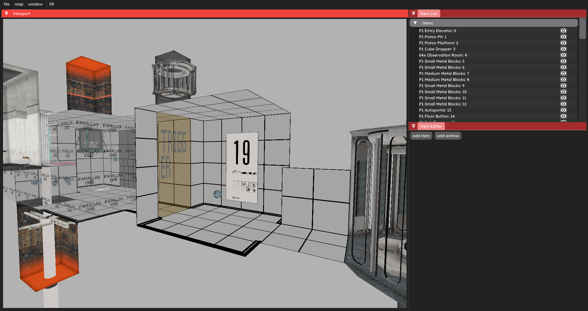|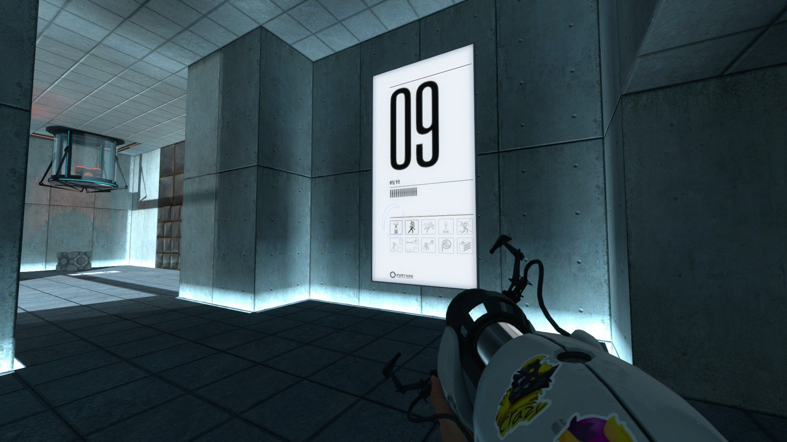|
|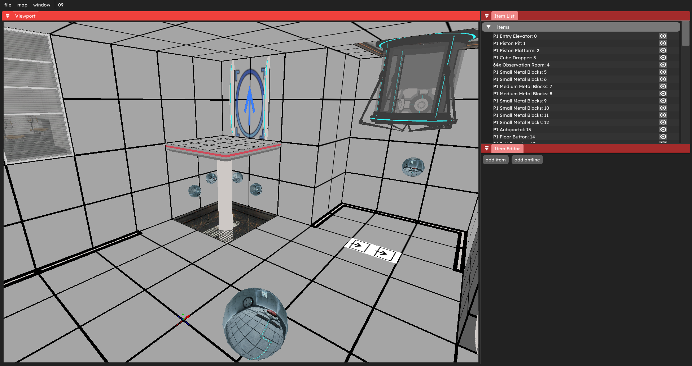|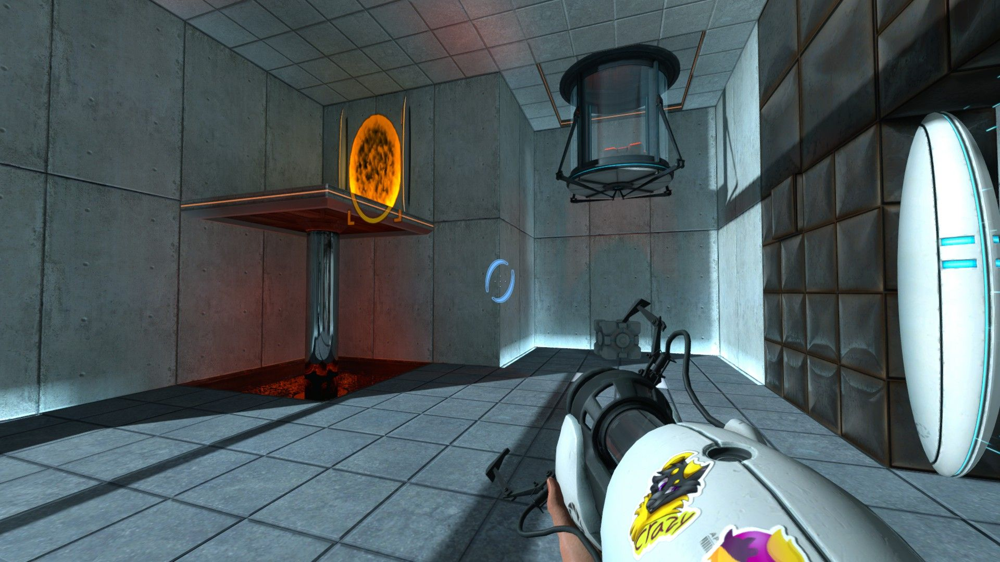|
|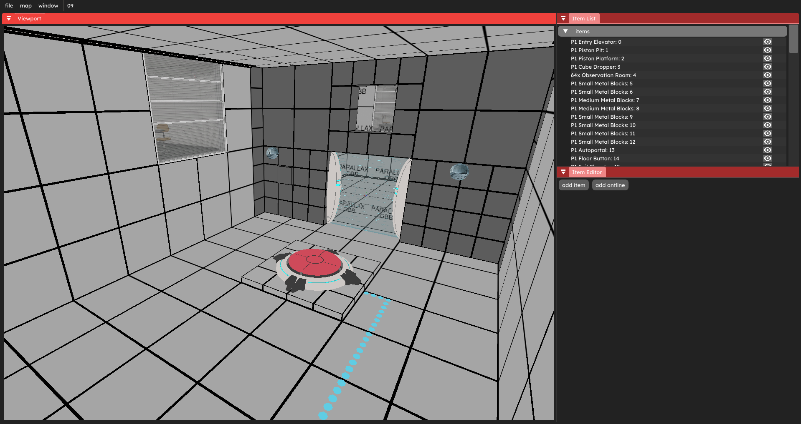|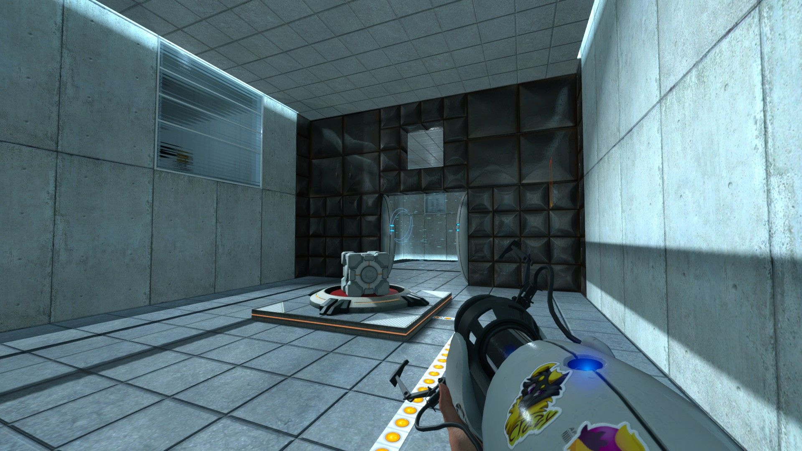|
|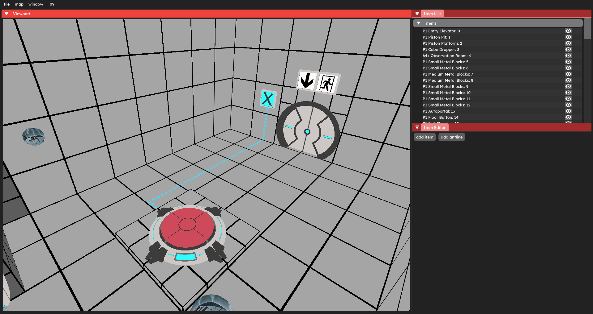|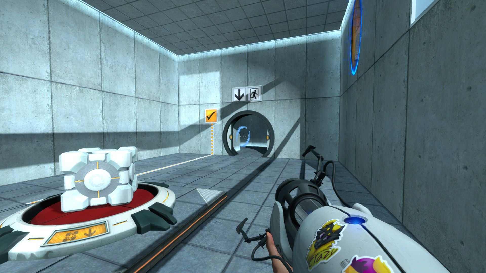|
|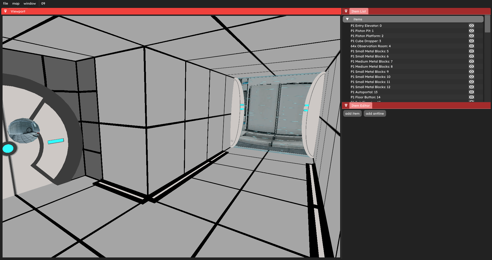|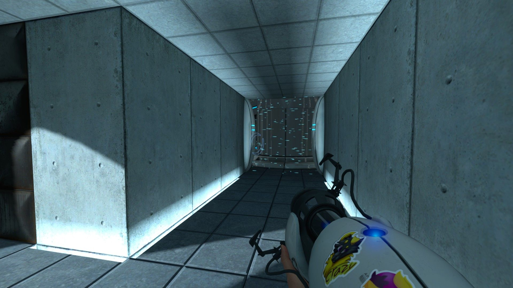|
|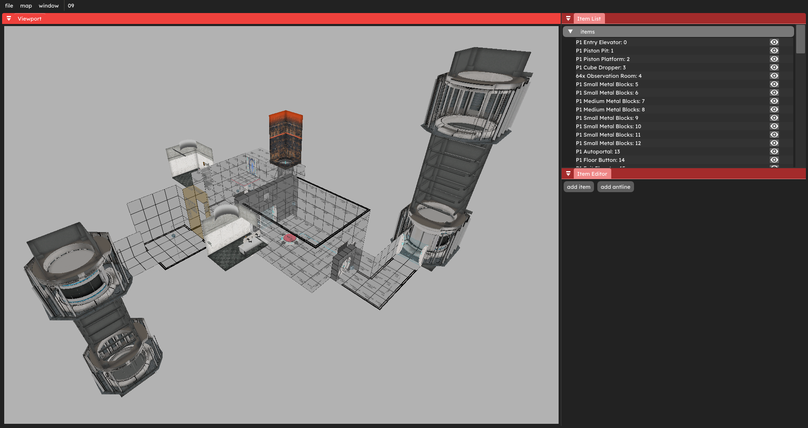|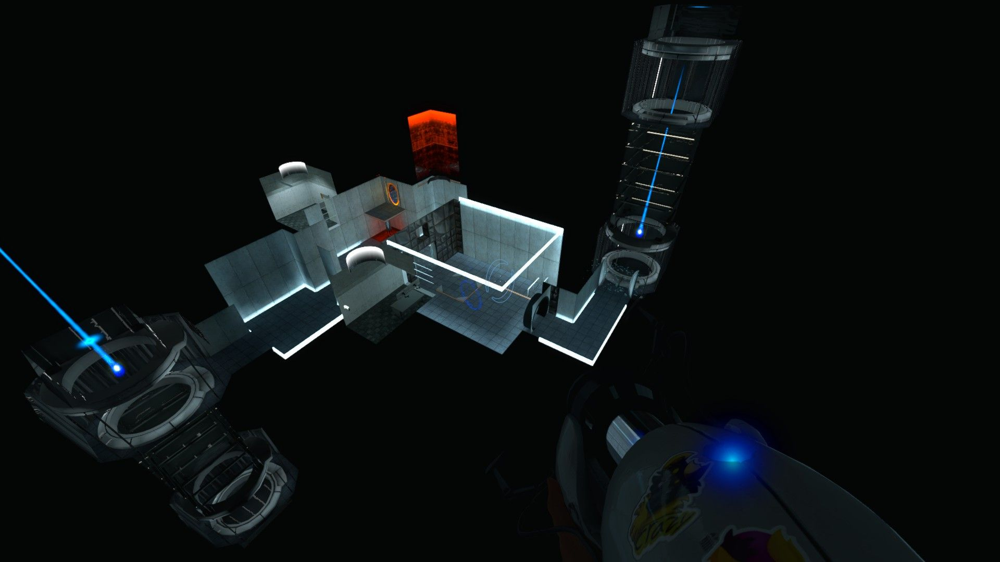|
